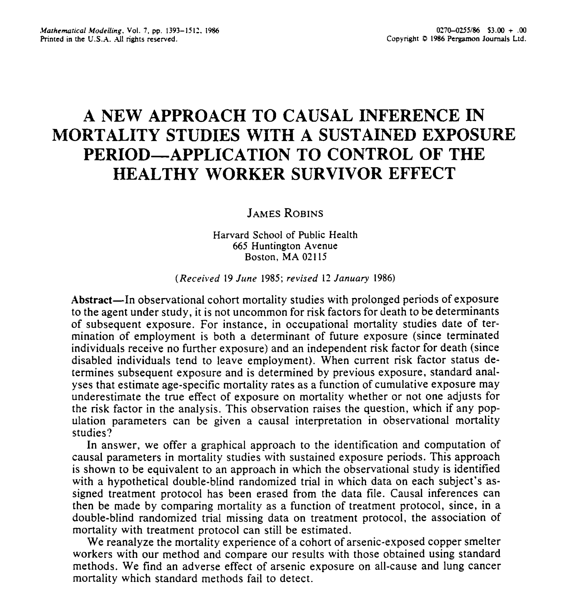
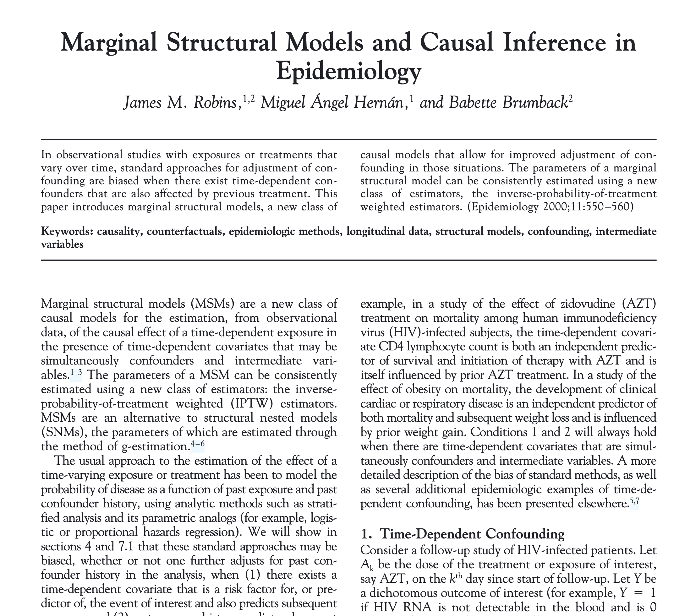
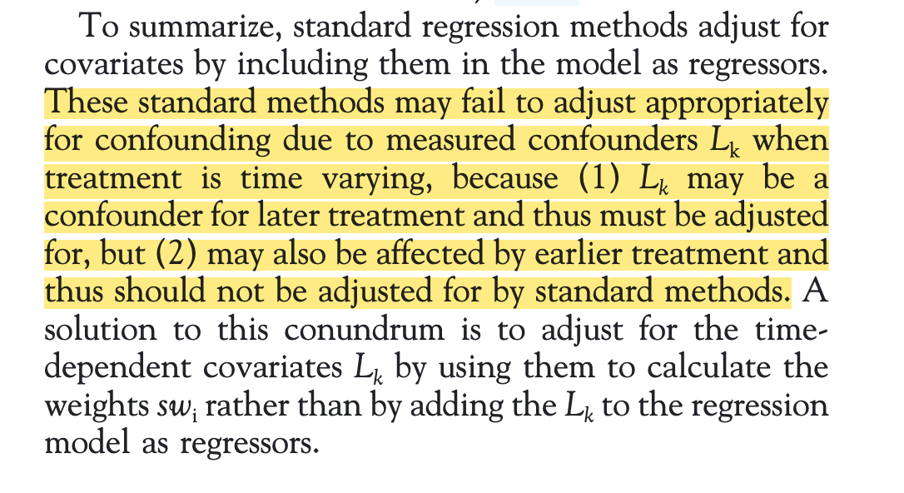
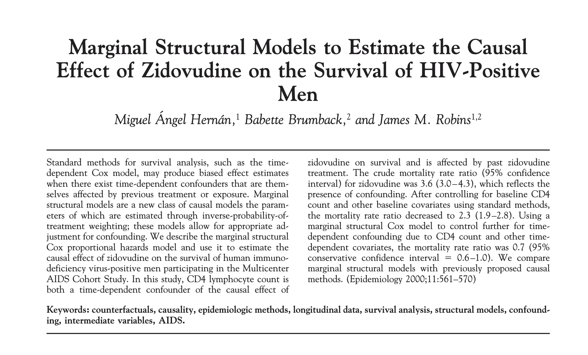
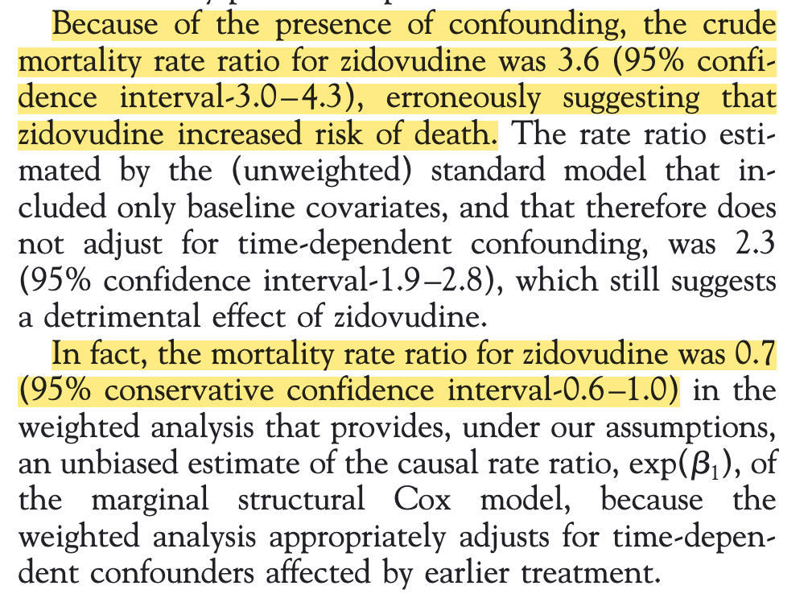

## Intro to Longitudinal Causal Inference

<br/>

<center>

``` {.tikz width="65%" fig-align="center"}
\begin{tikzpicture}[node distance=16mm]
  \node[rv, covcol, left=of A0] (L0) {$L(0)$};
  \node[rv, trtcol] (A0) {$A(0)$};
  \node[rv, covcol, right=of A0] (L1) {$L(1)$};
  \node[rv, trtcol, right=of L1] (A1) {$A(1)$};
  \node[rv, outcol, right=of A1] (Y)  {$Y$};

  % \draw[arr] (L0) -- (A0);
  % \draw[arr] (A0) -- (L1);
  % \draw[arr] (L1) -- (A1);
  % \draw[arr] (A1) -- (Y);
  % \draw[arr] (L0) -- (A0);
  % \draw[arr] (A0) to[bend left=32] (A1);
  % \draw[arr] (A0) to[bend left=45] (Y);
  % \draw[arr] (L1) to[bend left=28] (Y);
\end{tikzpicture}
```

</center>

what arrows are needed? what situation are we trying to describe?

## Origins of Observational Causal Inference

On the tails of wide acceptance of smoking $\to$ lung cancer, James Robins invents a lot of what we use today.



## Then the HIV/AIDS crisis happens



## 

## But what did it mean for HIV/AIDS trials?



## 

## Let's take a step back

::: incremental
-   It takes some effort to learn longitudinal g-methods and implement them well.
-   There are yet more causal estimands in the longitudinal setting.
-   How can you do the best job you can on a longitudinal data analysis for this class?
-   Maybe the work you do will/won't be fully causal, but it can be the stepping stone to even more rigorous work and public health advocacy.
:::

## Let's take a look at some causal-adjacent concepts

::: incremental
-   Interrupted Time-Series
-   Parallel Trends
-   . . .
<!-- -   <small> *At this point, I should give a content warning that the next several slides will deal with heavy topics including suicide rates, infant mortality rates, firearm deaths, etc.* These topics are not brought up lightly, but rather because they are indicators of profound and inarguable human suffering that can be be understood and made into actionable evidence to reduce human suffering through population health data analysis. </small> --> 
:::

```{=html}
<!--

LIST OF SOURCES TO TALK ABOUT: 

- Suicides associated with the 2008-10 economic recession in England: time trend analysis 
- https://www.bmj.com/content/345/bmj.e5142 

- Effects of Medicaid Drug-Payment Limits on Admission to Hospitals
and Nursing Homes 
https://www.nejm.org/doi/10.1056/NEJM199110103251505 

-  Decline in pneumonia admissions after routine childhood immunisation with pneumococcal conjugate vaccine in the USA: a time-series analysis  
- https://hollis.harvard.edu/discovery/search?query=any,contains,Decline%20in%20pneumonia%20admissions%20after%20routine%20childhood%20immunisation%20with%20pneumococcal%20conjugate%20vaccine%20in%20the%20USA:%20a%20time-series%20analysis&tab=Everything&search_scope=MyInst_and_CI&vid=01HVD_INST:HVD2&offset=0

- Short term impact of smoke-free legislation in England:
retrospective analysis of hospital admissions for myocardial
infarction 
- https://www.bmj.com/content/bmj/340/bmj.c2161.full.pdf 

- Long term effect of reduced pack sizes of paracetamol on poisoning deaths and liver transplant activity in England and Wales: interrupted time series analyses  
- https://pubmed.ncbi.nlm.nih.gov/23393081/


- Evaluating the impact of "stand your ground" 
https://www.ag-myresearch.com/uploads/1/3/8/6/13864925/2020_degliesposti_ije.pdf 

- Asssociation between the release of Netflix' 13 reasons why 
https://www.jaacap.org/article/s0890-8567(19)30288-6/fulltext#fig1 

Can synthetic controls improve causal inference
in interrupted time series evaluations of public
health interventions?
- https://www.ag-myresearch.com/uploads/1/3/8/6/13864925/2020_degliesposti_ije.pdf 


-->
```

## References
<small>
-   Hernán and Robins, What If Part III
-   Robins & Hernán, *Estimation of the causal effects of time-varying exposures* Ch. 23 in Longitudinal Data Analysis, 2009.
-   Robins, Hernán, Brumback, *Marginal structural models and causal inference in epidemiology.* 2000

- Suicides associated with the 2008-10 economic recession in England: time trend analysis  <https://www.bmj.com/content/345/bmj.e5142> 
- Effects of Medicaid Drug-Payment Limits on Admission to Hospitals
and Nursing Homes 
<https://www.nejm.org/doi/10.1056/NEJM199110103251505>
-  Decline in pneumonia admissions after routine childhood immunisation with pneumococcal conjugate vaccine in the USA: a time-series analysis <https://www.thelancet.com/journals/lancet/article/PIIS0140-6736(07)60564-9/abstract>
- Short term impact of smoke-free legislation in England:
retrospective analysis of hospital admissions for myocardial
infarction  <https://www.bmj.com/content/bmj/340/bmj.c2161.full.pdf>
- Long term effect of reduced pack sizes of paracetamol on poisoning deaths and liver transplant activity in England and Wales: interrupted time series analyses <https://pubmed.ncbi.nlm.nih.gov/23393081/>
- Evaluating the impact of "stand your ground" 
<https://www.ag-myresearch.com/uploads/1/3/8/6/13864925/2020_degliesposti_ije.pdf> 
- Asssociation between the release of Netflix' 13 reasons why  <https://www.jaacap.org/article/s0890-8567(19)30288-6/fulltext#fig1> 
- Can synthetic controls improve causal inference
in interrupted time series evaluations of public
health interventions? <https://www.ag-myresearch.com/uploads/1/3/8/6/13864925/2020_degliesposti_ije.pdf> 

</small>
